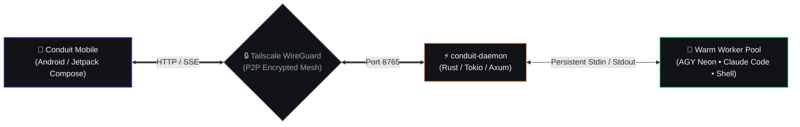
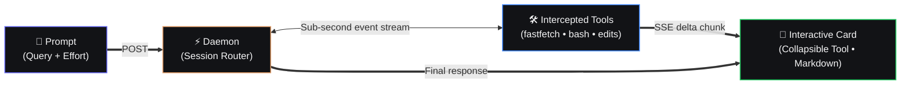

# Conduit ⚡
### Minimalist Mobile AI IDE & Workstation Bridge

<p align="center">
  <b>Conduit</b> turns your Android phone into an ultra-fast, distraction-free mobile terminal and AI IDE powered directly by your desktop workstation over Tailscale. Zero external paid API middle-layers, zero cloud dependency.
</p>

<p align="center">
  
  
  
  
  
</p>

---

## ✦ Why Conduit?

Most mobile developer apps fall into two traps:
1. **Cluttered AI "Slop"**: Bloated dashboards covered in redundant git trees, harsh borders, low-contrast terminal dumps, and complex multi-pane clutter.
2. **High Latency & Expensive APIs**: Routing every single keystroke or thought through costly cloud APIs or spawning cold CLI processes per prompt (6–12s delay).

**Conduit** eliminates both:
- **Clean Aesthetic**: Linear / Vercel dark mode (`#0D0E11` deep zinc palette, soft glowing accents, zero visual noise).
- **Sub-Second Native Latency**: A warm Rust daemon process pool (`conduit-daemon`) maintains active stdin/stdout connections with your local CLI models (Claude Code, Gemini 3.8 / 4 Neon), dropping turn latency from seconds down to milliseconds.
- **Deep Tailscale Integration**: Encrypted, peer-to-peer connection between your phone and PC wherever you have an internet connection.

---

## 🏛️ Architecture Overview



---

## ✨ Key Features

### 1. Unified Model Picker & Effort Spectrum Slider
Instead of cluttered, separate model configurations, Conduit collapses reasoning models into one unified selector:
- **Base Models**: Gemini 4 Neon, Gemini 3.8 Flash, Claude 3.7 Sonnet, etc.
- **Circular Spectrum Slider**: Smooth, physics-based spring animation across a dynamic color map:
  $$\text{Low (Warm Red)} \longrightarrow \text{Medium (Gold)} \longrightarrow \text{High (Emerald Green)} \longrightarrow \text{Max (Royal Blue / Violet)}$$

### 2. Collapsible Desktop Tool Activity Cards
Commands run by the AI (`fastfetch`, file edits, git commands) are intercepted as streaming JSON events by the daemon and formatted into collapsible cards:
- `● Ran fastfetch (exit 0)`
- Expandable with one tap to inspect full stdout/stderr with syntax-highlighted monospace terminal output and one-click copy.

### 3. Native Markdown & Code Syntax Highlighting
- Custom AST renderer for headings, lists, inline formatting (`**bold**`, `*italic*`, `` `code` ``).
- Multi-language syntax-highlighted code blocks with dedicated tap-to-copy headers.

### 4. Direct PC Shell & Workstation Stats
- Inspect live RAM, CPU, swap, battery, uptime, and desktop environment directly in the workspace.
- Pull instant desktop screenshot frames straight to your phone.
- Bi-directional clipboard syncing with native Linux desktop (`wl-copy` / `xclip`).

---

## 🔄 Stream & Execution Flow



---

## 🚀 Getting Started

### Prerequisites
- **Workstation**: Linux (Fedora, Arch, Ubuntu, etc.) with Rust (`cargo`) installed.
- **Mobile**: Android 9.0+ (API 28+).
- **Network**: [Tailscale](https://tailscale.com/) installed on both phone and PC (or use USB cable via ADB).

### 1. Setup PC Daemon
The daemon runs as a lightweight user systemd service:

```bash
cd pc/conduit-daemon
cargo build --release

# Copy the binary & service configuration
cp target/release/conduit-daemon ~/.local/bin/ # or keep in workspace
cp ../conduit-pc.service ~/.config/systemd/user/

# Enable and start the background daemon
systemctl --user daemon-reload
systemctl --user enable --now conduit-pc.service
```

Verify it's alive:
```bash
curl http://127.0.0.1:8765/ping
# Output: conduit-pc
```

### 2. Build & Install Android App
```bash
# Connect phone via USB with USB Debugging enabled
./gradlew assembleDebug

# Install to connected device
adb install -r app/build/outputs/apk/debug/app-debug.apk

# (Optional USB port forward for tethered testing)
adb reverse tcp:8765 tcp:8765
```

---

## 📂 Repository Structure

```
Conduit/
├── app/                        # Android Client (Jetpack Compose)
│   ├── src/main/java/com/example/conduit/
│   │   ├── ui/
│   │   │   ├── IdeWorkspaceScreen.kt    # Main AI stream, AST Markdown, slider
│   │   │   ├── SettingsToolsDrawer.kt   # System info, clipboard, connection
│   │   │   └── theme/                   # Zinc dark palette & typography
│   │   ├── ConduitRepository.kt         # Network transport & state management
│   │   ├── IdeModels.kt                 # Markdown lexer & tool AST parser
│   │   └── MainActivity.kt              # App entrypoint
├── pc/                         # Workstation Daemon & Scripts
│   ├── conduit-daemon/         # High-performance Rust daemon
│   │   ├── src/main.rs         # HTTP/SSE endpoints (Axum)
│   │   ├── src/sessions.rs     # Warm CLI process management & tool parser
│   │   └── src/sys.rs          # System stats, screenshots, clipboard
│   ├── conduit-pc.service      # User systemd service unit
│   └── conduit_pc.py           # Fallback/standalone Python utilities
└── README.md
```

---

## 🛡️ License
Distributed under the MIT License. See `LICENSE` for more information.
